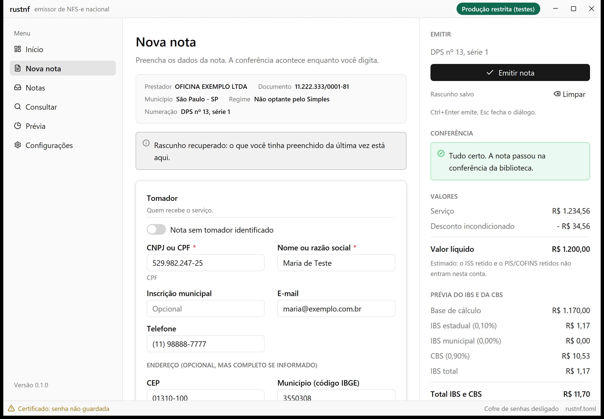

# rustnf

Emissor aberto de NFS-e do padrão nacional (Sefin Nacional / ADN), escrito em Rust: uma biblioteca, um binário
(`rustnf`) que oferece **linha de comando**, **API HTTP** e **servidor MCP** no mesmo executável, e uma
**interface de desktop** para Windows (`rustnf-gui`).

> **Aviso: este projeto NÃO é software oficial** da Receita Federal, do Comitê Gestor da NFS-e nem de qualquer
> prefeitura. Ele segue a documentação pública (fontes em `docs/FONTES.md`); a responsabilidade pelo uso em produção é
> de quem o opera. Emitir ou cancelar nota em produção tem efeito fiscal. Teste antes na produção restrita.




As telas acima são da interface de desktop, com dados fictícios.

## Emitir uma nota: passo a passo

Pela interface de desktop (Windows):

1. Baixe o `.zip` da versão mais recente em [Releases](https://github.com/Admnwk/rustnf/releases), descompacte e abra o
   `rustnf-gui.exe` (sobre o aviso do Windows no primeiro uso, veja [Baixar pronto](#baixar-pronto)).
2. No primeiro uso, preencha os três passos: os dados do **emitente**, o **certificado A1** (o arquivo `.pfx` e a senha,
   com o botão "Testar certificado") e a **pasta das notas**.
3. Confira, no canto superior direito, que o ambiente é **Produção restrita (testes)**. É o padrão; nele as notas não
   têm efeito fiscal.
4. Abra **Nova nota** e preencha o tomador, o serviço e os valores. O painel ao lado mostra o que falta; quando ele
   disser "Tudo certo", clique em **Emitir nota** e confirme.
5. A nota autorizada aparece em **Notas**: abra-a para ver os dados, gerar o DANFSe em PDF ou cancelar.
6. Quando os testes derem certo, troque o ambiente para **Produção** em Configurações. A partir daí cada nota tem valor
   fiscal, e a tela pede uma confirmação a mais antes de emitir.

Pela linha de comando (Windows ou Linux), com o pedido em JSON (modelo em `crates/rustnf-cli/exemplos/dps.json`):

```
$ export SENHA_A1='...'
$ rustnf dps conferir pedido.json
$ rustnf emitir pedido.json --pfx certificado.pfx --senha-env SENHA_A1 --ambiente restrita
```

Os detalhes de cada passo estão em [Interface de desktop](#interface-de-desktop) e em
[Linha de comando](#linha-de-comando).

## Estado

**Nenhuma nota real foi emitida com este código até agora**, nem em produção restrita. O que existe hoje:

| parte | como foi conferida | o que falta |
|---|---|---|
| XML da DPS e regras antes do envio | contratos em `crates/rustnf/tests/casos/`, comparados texto a texto; regras lidas no Anexo I oficial | a Sefin Nacional aceitar uma DPS gerada aqui |
| assinatura | conferida pelo próprio verificador e por um XML assinado fora da biblioteca | a Sefin Nacional validar uma assinatura feita aqui, em SHA-256 (o padrão) ou em SHA-1 (`--assinatura sha1`) |
| cliente da Sefin Nacional | transporte falso (resposta perdida, 5xx, E0014, consulta, cancelamento) | uma chamada real, com TLS mútuo e certificado A1 |
| prévia do IBS/CBS | casos de teste da calculadora oficial da Receita Federal | comparar com os valores de uma NFS-e autorizada |
| DANFSe | contrato de conteúdo e leiaute | comparar com um DANFSe emitido pelo portal |
| interface de desktop (`rustnf-gui`, só Windows) | testes do modelo (máscaras, conferência, pedido, prévia, sugestão, rascunho, lista das notas, detalhe, cancelamento, consulta pela chave e prévia avulsa), dos fluxos com emissor de demonstração e pasta temporária e da janela no ambiente de teste do GPUI; uso manual da janela em modo de depuração e pelo exemplo de demonstração | **emitir, consultar ou cancelar uma nota real pela janela: nenhuma nota real foi emitida, consultada nem cancelada por esta interface, só o emissor de demonstração respondeu**; o DANFSe aberto no leitor de PDF de outra máquina; uma chamada real à Sefin pelo botão "Testar conexão"; exame da janela em outras escalas de tela; o executável de release aberto numa máquina sem as ferramentas de desenvolvimento |

Se você testar, conte como foi: abra um relato pelo modelo **"Relato de emissão"** (aba Issues), mesmo quando der
certo. Correção é bem-vinda por pedido de mudança, com a fonte oficial citada e um caso no contrato (veja
`CONTRIBUTING.md`). Comece sempre pela produção restrita. Se a assinatura for recusada, repita com
`--assinatura sha1` e diga no relato qual das duas passou.

## O que faz

| comando | o que faz |
|---|---|
| `rustnf dps montar` | lê o JSON de um pedido e escreve o XML da DPS (não assinado) |
| `rustnf dps conferir` | confere as regras do Anexo I e diz "ok" ou a recusa (campo e motivo) |
| `rustnf dps esquema` | imprime o JSON Schema do pedido da DPS |
| `rustnf calcular` | prévia da base de cálculo e do IBS/CBS (Reforma Tributária, LC 214/2025), como a calculadora da Receita Federal |
| `rustnf danfse` | gera o DANFSe em PDF (NT 008) a partir do XML da NFS-e autorizada, ou de uma nota da pasta de notas (`--chave`) |
| `rustnf emitir` | monta, assina com o certificado A1 e envia a DPS à Sefin Nacional (idempotente) |
| `rustnf consultar` | consulta uma NFS-e pela chave de acesso |
| `rustnf cancelar` | cancela uma NFS-e (evento 101101) |
| `rustnf serve` | sobe a API HTTP e o servidor MCP |
| `rustnf config mostrar` / `caminho` | a configuração efetiva e de onde veio; o arquivo em uso |
| `rustnf senha guardar` / `apagar` | guarda a senha do certificado no cofre do sistema (Windows) |
| `rustnf notas listar` | lista as notas guardadas na pasta de notas, com filtro por período, situação e texto; em texto, JSON ou CSV |
| `rustnf notas exportar` | copia para uma pasta os XML das notas de um mês e a lista delas em CSV (o que vai para a contabilidade) |
| `rustnf notas reindexar` | refaz o índice da pasta de notas a partir dos XML guardados |
| `rustnf notas numero` | mostra a próxima DPS da série; com `--proximo`, continua a numeração de quem já emitia por outro sistema |
| `rustnf certificado mostrar` | mostra o titular, o documento, a validade e os avisos do certificado A1 |
| `rustnf sefin testar` | testa a conexão com a Sefin Nacional e a aceitação do certificado |

Nenhuma regra fiscal mora no binário: ele lê a entrada, chama a biblioteca (`crates/rustnf`) e escreve a saída. A
biblioteca monta a DPS (leiaute 1.01 de produção e NT 009 de produção restrita), confere as regras antes do envio,
lê o retorno, calcula a prévia do IBS/CBS, gera o DANFSe e fala com a Sefin Nacional por mTLS com o A1 em memória.
Valores e percentuais usam inteiros de ponto fixo, nunca ponto flutuante. A DPS não leva IBS/CBS calculado (quem
calcula é a Sefin Nacional): `calcular` é só uma prévia; vale o que voltar na NFS-e.

## Instalação

### Baixar pronto

Cada versão publicada traz, na página de Releases, um `.zip` para Windows (64 bits) com `rustnf.exe` (linha de comando)
e `rustnf-gui.exe` (interface de desktop), e um `.tar.gz` com a linha de comando para Linux. Não há instalador:
descompacte e execute. As versões anteriores continuam na mesma página, para quem preferir. No Windows (10 ou 11)
não é preciso instalar mais nada: a biblioteca C vai dentro do executável. Para emitir você precisa do seu certificado
A1 (`.pfx`) e da senha dele.

O executável **não tem assinatura de código**. No primeiro uso o Windows pode mostrar "O Windows protegeu o
computador" (SmartScreen): clique em "Mais informações" e depois em "Executar assim mesmo". Antes, confira o
SHA-256 do arquivo baixado com o `SHA256SUMS.txt` da mesma release (no PowerShell:
`Get-FileHash arquivo.zip -Algorithm SHA256`).

### Compilar

Precisa do Rust estável 1.92 ou mais novo: é a versão mínima que as dependências declaram. O projeto é compilado e
testado com a versão estável atual.

```
git clone https://github.com/Admnwk/rustnf
cd rustnf
cargo build --release -p rustnf-cli
```

O executável fica em `target/release/rustnf` (`rustnf.exe` no Windows). A interface de desktop é outro executável, só
para Windows (veja [Interface de desktop](#interface-de-desktop)). A biblioteca e a camada de aplicação
(`crates/rustnf-app`: operações, configuração, cofre e pasta de notas, sem tela nem servidor) são compartilhadas pelo
binário e por qualquer interface que use o mesmo arquivo de configuração. Não é preciso nenhum programa externo: o
DANFSe em PDF é escrito pelo próprio binário, com as fontes embutidas.

## Linha de comando

Convenções: dado no stdout, diagnóstico no stderr; `--json` onde a saída padrão é texto; onde se espera um arquivo,
`-` lê do stdin. Códigos de saída:

| código | significado |
|---|---|
| 0 | ok |
| 1 | falha interna |
| 2 | erro de uso ou de entrada (opção errada, JSON inválido, arquivo ausente, certificado que não abre) |
| 3 | recusa de regra (a DPS não passa no Anexo I, a prévia não pode calcular, a Sefin rejeitou) |
| 4 | erro de rede ou resposta de erro da Sefin Nacional |

Os exemplos abaixo usam os arquivos de `crates/rustnf-cli/exemplos/` (só documentos fictícios).

Para completar comandos e opções com Tab, gere o script do seu shell (powershell, bash, zsh, fish ou elvish):

```sh
rustnf completar powershell | Out-String | Invoke-Expression   # PowerShell; ponha no $PROFILE para valer sempre
source <(rustnf completar bash)                                 # bash
```

### Montar e conferir a DPS

```
$ rustnf dps montar crates/rustnf-cli/exemplos/dps.json
<?xml version="1.0" encoding="UTF-8"?><DPS xmlns="http://www.sped.fazenda.gov.br/nfse" versao="1.01"><infDPS Id="DPS3550308..."> ...

$ rustnf dps conferir crates/rustnf-cli/exemplos/dps.json
ok

$ rustnf dps conferir pedido-com-erro.json --json     # saida 3
{"campo": "infDPS/prest/regTrib/regApTribSN", "codigo": "recusa", "mensagem": "...", "ok": false}
```

O JSON do pedido tem a forma de `rustnf::nfse::Dps` (veja `crates/rustnf/tests/casos/nfse_nacional.json` para dezenas
de casos). Valores aceitam número ou texto. `rustnf dps esquema` imprime o JSON Schema do pedido, com a descrição de
cada campo (`--emissao` para o do `emitir`, que não exige o que a configuração completa).

**Campo de nome errado.** Um campo que a DPS não conhece (erro de digitação, campo no grupo errado) não entra no XML.
O `emitir` o **recusa** (código 3) antes de abrir o certificado e de qualquer envio: uma nota sem o desconto que se
quis dar tem valor fiscal. Para emitir mesmo assim, ignorando o campo, use `--ignorar-desconhecidos`. `dps montar` e
`dps conferir` só avisam no stderr, com o caminho (`valores.desconto_incondicional`), e a saída `--json` traz a lista em
`campos_desconhecidos`; com `--estrito`, eles também recusam:

```
$ rustnf dps conferir pedido.json
ok
aviso: campo desconhecido no pedido, ignorado: valores.desconto_incondicional (confira o nome)

$ rustnf dps conferir pedido.json --estrito          # saida 3
erro: valores.desconto_incondicional: campo desconhecido no pedido: confira o nome
```

### Prévia do IBS/CBS

```
$ rustnf calcular crates/rustnf-cli/exemplos/calculo.json
{
  "bases": { "regime_regular": "80.00", "simples": null, "avisos": [], "erros": [] },
  "recusado": false,
  "tributos": { "base": "80.00", "ibs": "0.08", "cbs": { "aliquota": "0.90", "devido": "0.72", ... }, ... }
}
```

O JSON tem `{"base": {...}}` e/ou `{"tributos": {...}}`. Se vierem os dois e `tributos.base` faltar, vale a base do
regime regular calculada. Se a base registrar recusas de regra (`bases.erros`), a conta sai mesmo assim, `recusado` é
`true` e o código de saída é 3.

### DANFSe

```
$ rustnf danfse crates/rustnf-cli/exemplos/nfse.xml -o danfse.pdf
DANFSe gravado: 116902 bytes
$ rustnf danfse nfse.xml -o danfse.pdf --situacao cancelada --sem-canhoto
```

`--situacao` aceita `valida` (padrão), `cancelada` e `substituida` (marca d'água da NT 008). `-o -` escreve o PDF no
stdout.

Com a [pasta de notas](#pasta-de-notas) configurada, basta a chave de acesso (colada com ou sem espaços):

```
$ rustnf danfse --chave <chave>
<pasta>/2026/10/<chave>.pdf
$ rustnf danfse --chave <chave> -o danfse.pdf
```

O PDF sai do XML guardado, com a marca de cancelada quando a nota está cancelada na pasta. Sem `-o`, ele fica ao lado
do XML e o caminho dele sai no stdout.

### Emitir, consultar e cancelar

Precisam do certificado A1 (`.pfx`/`.p12`), do ambiente e da senha. **A senha nunca vem por argumento** (apareceria na
lista de processos e no histórico do shell): só por variável de ambiente (`--senha-env`) ou pela primeira linha do
stdin (`--senha-stdin`).

```
$ export SENHA_A1='...'
$ rustnf emitir pedido.json --pfx certificado.pfx --senha-env SENHA_A1 --ambiente restrita
autorizada
chave: <50 posicoes>
numero: 77

$ printf '%s\n' "$SENHA_A1" | rustnf consultar --chave <chave> --pfx certificado.pfx --senha-stdin --ambiente restrita --json

$ rustnf cancelar --chave <chave> --motivo 1 --justificativa "Valor digitado errado na nota" \
    --pfx certificado.pfx --senha-env SENHA_A1 --ambiente restrita
```

* `--ambiente producao|restrita` prevalece sobre o `ambiente` do pedido. Sem arquivo de configuração ele é obrigatório;
  com arquivo (ou `RUSTNF_AMBIENTE`), vale o `[sefin].ambiente`. `--pfx` segue a mesma regra.
* Sem `--senha-env` nem `--senha-stdin`, a senha vem do cofre do sistema, se houver uma guardada (veja
  [Configuração](#configuração)).
* Sem `emissao` (`dhEmi`) no pedido, vale "agora menos 60 s" (`--folga-relogio`), para o relógio local adiantado não
  cair na regra E0008.
* A emissão é idempotente: resposta perdida, erro 5xx ou E0014 fazem a biblioteca consultar a DPS antes de reenviar o
  MESMO XML. Nunca renumere a DPS (`numero`) para "tentar de novo".
* A DPS e os eventos são assinados com RSA e SHA-256. `--assinatura sha1` (ou `RUSTNF_ASSINATURA`, ou
  `[sefin].assinatura`) troca para SHA-1; o leiaute não fixa o algoritmo.
* Motivos de cancelamento: `1` erro na emissão, `2` serviço não prestado, `9` outros; a justificativa é obrigatória.
* `--json` imprime o resultado completo (inclui a NFS-e lida e os alertas); sem ele, um resumo.
* O pedido com campo desconhecido é recusado antes de abrir o certificado; `--ignorar-desconhecidos` emite mesmo
  assim, sem o campo (veja [Montar e conferir a DPS](#montar-e-conferir-a-dps)).

## Configuração

Um arquivo TOML único, lido pela linha de comando e por qualquer outra interface. Exemplo comentado, só com dados
fictícios: [`crates/rustnf-cli/exemplos/rustnf.toml`](crates/rustnf-cli/exemplos/rustnf.toml).

**Onde ele mora.** `--config <arquivo>` (arquivo inexistente é erro); sem a opção, a variável de ambiente
`RUSTNF_CONFIG` (inexistente também é erro); sem ela, o local padrão: no Windows `%APPDATA%\rustnf\rustnf.toml`, nos
outros sistemas `$XDG_CONFIG_HOME/rustnf/rustnf.toml` ou `$HOME/.config/rustnf/rustnf.toml`. Se nem o local padrão
existir, valem os padrões e nada muda em relação a usar só opções. `rustnf config caminho` mostra o que vale e
`rustnf config mostrar [--json]` mostra a configuração efetiva e de onde veio.

**Precedência**, em todo parâmetro: opção da chamada > variável de ambiente `RUSTNF_*` > arquivo > padrão. As
variáveis: `RUSTNF_AMBIENTE`, `RUSTNF_PFX`, `RUSTNF_ASSINATURA`, `RUSTNF_TEMPO_LIMITE_SEFIN`, `RUSTNF_FOLGA_RELOGIO`,
`RUSTNF_SERIE`, `RUSTNF_NOTAS_PASTA`, `RUSTNF_CANHOTO`, `RUSTNF_ENDERECO`, `RUSTNF_PORTA`, `RUSTNF_LIMITE_CORPO`,
`RUSTNF_TEMPO_LIMITE` e `RUSTNF_ORIGENS_PERMITIDAS` (separadas por vírgula). Campo desconhecido no arquivo é recusado,
e os valores são conferidos (ambiente, código do município, CNPJ/CPF, números, anos de alíquota repetidos...) com a
seção e o campo no erro.

| seção | campos |
|---|---|
| `[emitente]` | `cnpj` ou `cpf`, `nome`, `inscricao_municipal`, `municipio` (IBGE, 7 dígitos), `op_simples` (1, 2 ou 3), `regime_apuracao` (0 = não informar), `regime_especial`, `serie`, `aliquota_iss` (vazio = não informar) |
| `[sefin]` | `ambiente` (`producao` ou `restrita`), `pfx`, `assinatura` (`sha256` ou `sha1`), `tempo_limite_s`, `folga_relogio_s` |
| `[notas]` | `pasta` (vazio = não guardar) |
| `[danfse]` | `canhoto` |
| `[servidor]` | `endereco`, `porta`, `limite_corpo`, `tempo_limite_s`, `origens_permitidas` |
| `[interface]` | `tema` (`sistema`, `claro` ou `escuro`; padrão `sistema`): preferência da interface de desktop, a linha de comando não a usa |
| `[[aliquotas]]` | `ano`, `cbs_referencia`, `cbs`, `ibs_uf`, `ibs_mun`, `fonte` (uma tabela por ano) |

* **`[emitente]`** completa o pedido da DPS no `emitir` (linha de comando, API HTTP e MCP), só nos campos que o pedido
  não traz (nunca sobrescreve): `prestador.documento`, `nome`, `im`, `op_simples`, `apuracao_sn`, `regime_especial`,
  `cmun_emissor` e `serie`. A `aliquota_iss` (ex. `2.00`) completa `valores.municipal.aliquota` só onde a DPS leva a
  alíquota: ISS tributável, sem regime especial, fora do MEI e, para ME/EPP, com o ISS retido. Configure-a só se o seu
  município não for conveniado ao sistema nacional (ou se for ME/EPP com ISS retido): em município conveniado a Sefin
  usa a alíquota do município e recusa a informada. Na interface, a Nova nota mostra o ISS estimado no resumo.
* **`[[aliquotas]]`** valem no `calcular` (linha de comando, API HTTP e MCP) quando o JSON não traz `publicadas`: sem
  elas, a prévia de 2027 em diante usa o que a biblioteca assume; com elas, usa o número publicado.
* **`[servidor]`** é o que `rustnf serve` usa quando a opção não é dada.
* **`[interface]`** guarda só o tema da interface de desktop; `sistema` segue o tema do Windows.
* **Sem segredo no arquivo.** Não existe campo de senha nem de token; `senha` ou `token` no arquivo é recusado como
  campo desconhecido.

### Cofre da senha do certificado

A senha do certificado vem de `--senha-env`, de `--senha-stdin` ou, na falta das duas, do **cofre do sistema**. No
Windows é o Gerenciador de Credenciais (serviço `rustnf`; o item é identificado pelo CNPJ do `[emitente]` ou, sem
ele, pelo nome do arquivo `.pfx`). Nos outros sistemas o cofre não é usado: continue com variável de ambiente ou stdin.
`RUSTNF_COFRE=desligado` desliga o cofre.

```
$ rustnf senha guardar --config rustnf.toml --senha-env SENHA_A1     # confere que a senha abre o .pfx e grava
$ rustnf emitir pedido.json --config rustnf.toml                    # sem --senha-env: usa o cofre
$ rustnf senha apagar --config rustnf.toml
```

A senha continua **impossível** de passar por argumento.

### Conferir o certificado e a conexão

```
$ rustnf certificado mostrar --config rustnf.toml
Certificado OK: OFICINA TESTE (11.***.***/****-81), valido ate 20/11/2027.
titular: OFICINA TESTE
documento: 11222333000181
emissor: AC EXEMPLO (ICP-Brasil)
validade: de 2026-11-20 a 2027-11-20 (364 dias)

$ rustnf sefin testar --config rustnf.toml
Conexao com o SEFIN ok, certificado aceito.
ambiente: restrita
```

* **`certificado mostrar`** abre o `.pfx` e não usa a rede. Os avisos (vence em 30 dias ou menos, não é da
  ICP-Brasil, é de outro CNPJ que o do `[emitente]`) saem no stderr. O CPF do titular aparece mascarado. Sai com
  código 3 quando o certificado não assina hoje (vencido ou ainda não válido), o que serve para um aviso agendado:
  com `--json`, o campo `dias_restantes` diz quanto falta.
* **`sefin testar`** faz **uma chamada real** à Sefin Nacional do ambiente configurado: a consulta de uma chave que
  não existe. A resposta "não encontrada" prova que a conexão e o certificado foram aceitos; nada é emitido nem
  alterado. Sai com código 3 se o certificado não assina hoje (nesse caso nada vai para a rede) e com 4 se a Sefin
  não respondeu ou recusou o certificado.

As duas aceitam `--pfx`, `--senha-env`, `--senha-stdin` e `--json`, com as mesmas regras de
[Emitir, consultar e cancelar](#emitir-consultar-e-cancelar).

### Pasta de notas

Com `[notas].pasta`, o `emitir` guarda cada nota autorizada, sem banco de dados:

```
<pasta>/<AAAA>/<MM>/<chave>.xml   o XML da NFS-e autorizada que a Sefin devolve
<pasta>/indice.json               chave, numero, serie, data, valor, situacao, documento e nome do tomador
<pasta>/estado.json               o ultimo numero de DPS usado em cada serie
<pasta>/<AAAA>/<MM>/<chave>.pdf   o DANFSe, quando ja foi gerado para a nota (nao entra no indice)
```

Sem `numero` no pedido, o `emitir` usa o próximo da série. O número só avança em nota autorizada ou recuperada
(rejeitada ou pendente não gasta número) e nunca volta atrás. Nota recuperada é a que já existia na Sefin com
aquela série e aquele número de DPS: se os dados dela não forem os do pedido (sobra de uma tentativa anterior), a
resposta traz `recuperada_difere` com o que difere (tomador, valor, código do serviço, competência) e a nota do pedido
NÃO foi emitida; emita de novo, que o número já avançou. O `cancelar` marca a nota como cancelada no índice; se a Sefin
recusar o pedido e a nota já tiver o cancelamento registrado (envio anterior sem resposta, ou feito em outro lugar), a
resposta é `registrado` com `recuperada: true`, e as mensagens da recusa vêm em `alertas`.
As gravações são atômicas (arquivo temporário e `rename`); o nome do arquivo vem só da chave de acesso conferida. A
emissão e o cancelamento pela API HTTP e pelo MCP usam a mesma pasta, do mesmo jeito.

```
$ rustnf notas listar                                       # todas, da mais recente para a mais antiga
$ rustnf notas listar --de 2026-10-01 --ate 2026-10-31      # um periodo (os dois dias inclusive)
$ rustnf notas listar --situacao cancelada --busca "padaria"
$ rustnf notas listar --csv > notas.csv                     # para planilha
$ rustnf notas exportar --mes 2026-10 --para contador/2026-10
$ rustnf notas reindexar
$ rustnf notas numero --proximo 1501                       # ja emitia por outro sistema: a ultima DPS foi a 1500
```

* **`listar`** filtra por período (`--de`, `--ate`), por situação (`--situacao autorizada|cancelada`) e por texto
  (`--busca`: nome do tomador sem acento, CPF/CNPJ dele, número da NFS-e ou da DPS, ou uma chave de acesso colada); os
  filtros valem juntos. `--json` e `--csv` trocam a saída. O CSV usa `;` como separador, vírgula decimal no valor e uma
  linha de títulos; texto que uma planilha leria como fórmula ganha um apóstrofo na frente.
* **`exportar`** copia para a pasta de destino o XML de cada nota do mês (`<chave>.xml`) e a lista delas
  (`notas.csv`). São cópias: nada sai da pasta de notas.
* **`reindexar`** refaz o `indice.json` a partir dos XML guardados, para quando o índice se perde ou fica ilegível. O
  índice que havia fica copiado como `indice.anterior.json`. O XML não diz se a nota foi cancelada: a marca de
  cancelada é aproveitada do índice anterior quando ele ainda é legível; se não for, todas voltam como autorizadas e o
  comando avisa. A numeração da DPS não muda.
* **`numero`** mostra a próxima DPS da série (a do `[emitente]`, ou `--serie`). Quem já emitia por outro sistema passa
  `--proximo` com o número seguinte ao da última DPS de lá: a série continua dali. A numeração só anda para a frente,
  porque um número já usado faria a Sefin devolver a nota antiga em vez de autorizar a nova. Na interface:
  Configurações > Notas e DANFSe > "Continuar deste número".

## API HTTP

```
rustnf serve                                   # 127.0.0.1:8080, so' leitura
rustnf serve --porta 0                         # qualquer porta livre (o endereco sai no stderr)
```

Opções: `--endereco` (padrão `127.0.0.1`), `--porta`, `--limite-corpo` (bytes; padrão 1048576),
`--tempo-limite` (segundos; padrão 60), `--origem-permitida` (repetível), `--folga-relogio`. Ctrl+C para o servidor
limpo.

| rota | corpo | resposta |
|---|---|---|
| `GET /health` | | `{"status":"ok","versao":"...","emissao":false}` |
| `POST /calcular` | JSON de `calcular` | JSON da prévia |
| `POST /dps/conferir` | JSON da DPS | `{"ok":true}` ou 422 com o campo |
| `POST /dps/montar` | JSON da DPS | `{"xml":"..."}` |
| `POST /danfse` | XML da NFS-e (`?situacao=cancelada&canhoto=false`) | `application/pdf` |
| `POST /emitir` | JSON da DPS | JSON do resultado (só com emissão) |
| `POST /cancelar` | `{"chave","motivo","justificativa"}` | JSON do resultado (só com emissão) |
| `GET /nfse/{chave}` | | JSON da NFS-e (só com emissão) |
| `POST /mcp` | mensagem JSON-RPC | veja abaixo |

```
$ curl -s http://127.0.0.1:8080/health
{"emissao":false,"status":"ok","versao":"0.3.0"}

$ curl -s -X POST http://127.0.0.1:8080/calcular -H 'Content-Type: application/json' \
    --data-binary @crates/rustnf-cli/exemplos/calculo.json

$ curl -s -X POST http://127.0.0.1:8080/dps/montar -H 'Content-Type: application/json' \
    --data-binary @crates/rustnf-cli/exemplos/dps.json

$ curl -s -X POST 'http://127.0.0.1:8080/danfse?situacao=valida' --data-binary @crates/rustnf-cli/exemplos/nfse.xml \
    -o danfse.pdf
```

### Emissão pela API

As rotas `/emitir`, `/cancelar` e `/nfse/{chave}` **nem existem** (404) sem `--permitir-emissao`. Com a opção, o
servidor exige certificado, ambiente e um token: sem token configurado, ele recusa subir.

```
$ export SENHA_A1='...'
$ export TOKEN_RUSTNF="$(head -c 48 /dev/urandom | base64 | tr -d '=+/\n')"      # 32 caracteres no minimo
$ rustnf serve --permitir-emissao --pfx certificado.pfx --senha-env SENHA_A1 \
    --ambiente restrita --token-env TOKEN_RUSTNF

$ curl -s -X POST http://127.0.0.1:8080/emitir -H "Authorization: Bearer $TOKEN_RUSTNF" \
    -H 'Content-Type: application/json' --data-binary @pedido.json
$ curl -s http://127.0.0.1:8080/nfse/<chave> -H "Authorization: Bearer $TOKEN_RUSTNF"
$ curl -s -X POST http://127.0.0.1:8080/cancelar -H "Authorization: Bearer $TOKEN_RUSTNF" \
    -H 'Content-Type: application/json' \
    -d '{"chave":"<chave>","motivo":"1","justificativa":"Valor digitado errado na nota"}'
```

O servidor lê o mesmo arquivo de configuração da linha de comando (`rustnf serve --config rustnf.toml`). No `/emitir`,
o `[emitente]` completa o que o pedido não traz; com `[notas].pasta`, o `numero` da DPS pode faltar (vale o próximo da
série), a nota autorizada é guardada e a resposta traz `guardada` e `numero_dps` (e `aviso` ou `recuperada_difere`,
nos casos descritos em [Pasta de notas](#pasta-de-notas)). No `/cancelar`, o cancelamento registrado marca a nota na
pasta. O servidor emite uma nota por vez, para duas emissões simultâneas não pegarem o mesmo número. Sem `[emitente]`
e sem pasta de notas, o pedido precisa vir completo, com o `numero`.

Campo que a DPS não conhece: o `/emitir` recusa o pedido (422, com o campo) antes de qualquer envio; com
`?estrito=false` ele emite sem o campo e a resposta traz a lista em `campos_desconhecidos`. `/dps/conferir` e
`/dps/montar` só devolvem a lista, a menos que a rota leve `?estrito=true`.

Segurança: escuta em `127.0.0.1` por padrão (fora dele o tráfego é HTTP puro: ponha um proxy com TLS na frente); sem
CORS; cabeçalho `Origin` de fora do próprio computador recebe 403; teto de corpo e tempo limite por requisição; token
comparado em tempo constante; o PDF é gerado fora do laço assíncrono. Todo erro tem o envelope único:

```
{"erro": {"codigo": "recusa", "mensagem": "...", "campo": "infDPS/serie"}}
```

Códigos: `entrada_invalida` (400), `nao_autorizado` (401), `nao_encontrada` (404), `corpo_grande` (413),
`recusa` (422), `sefin` (502), `tempo_esgotado` (504), `erro_interno` (500). A mensagem nunca traz caminho de arquivo,
senha, token, chave de acesso nem o XML assinado, e nada disso vai para o registro do servidor (stderr).

## MCP

`POST /mcp` no mesmo servidor, transporte **Streamable HTTP** com resposta JSON (sem SSE) e sem estado. Implementa a
revisão **2026-07-28** da especificação
(<https://modelcontextprotocol.io/specification/2026-07-28/basic/transports/streamable-http>): cada requisição leva
a versão e as capacidades em `_meta` e os cabeçalhos `MCP-Protocol-Version`, `Mcp-Method` e `Mcp-Name`; também atende
`initialize` da revisão 2025-11-25 para clientes mais antigos. Ferramentas:

| ferramenta | o que faz |
|---|---|
| `calcular_cbs_ibs` | prévia do IBS/CBS (mesmo JSON de `calcular`) |
| `conferir_dps` | confere a DPS; recusa volta com `isError: true` |
| `montar_dps` | XML da DPS |
| `gerar_danfse` | PDF em base64, num recurso embutido |
| `emitir_nfse` | emite como o `POST /emitir`; só com `--permitir-emissao` e o Bearer |
| `consultar_nfse` | consulta pela chave de acesso; só com `--permitir-emissao` e o Bearer |
| `cancelar_nfse` | cancela como o `POST /cancelar`; só com `--permitir-emissao` e o Bearer |

Recusa de regra fiscal volta como resultado da ferramenta com `isError: true`, não como erro de protocolo. Campo que
a DPS não conhece volta listado em `campos_desconhecidos` no `conferir_dps`, e no `emitir_nfse` recusa o pedido
(`isError: true`) antes de qualquer envio. Sem o
Bearer, `tools/list` mostra só as quatro de leitura. Cada ferramenta tem `inputSchema` (JSON Schema). Exemplo:

```
$ curl -s -X POST http://127.0.0.1:8080/mcp \
    -H 'Content-Type: application/json' -H 'Accept: application/json, text/event-stream' \
    -H 'MCP-Protocol-Version: 2026-07-28' -H 'Mcp-Method: tools/call' -H 'Mcp-Name: conferir_dps' \
    -d '{"jsonrpc":"2.0","id":1,"method":"tools/call","params":{
          "name":"conferir_dps","arguments":{...a DPS...},
          "_meta":{"io.modelcontextprotocol/protocolVersion":"2026-07-28",
                   "io.modelcontextprotocol/clientCapabilities":{}}}}'
```

Fora do que foi implementado: respostas em fluxo (SSE) e `subscriptions/listen`, `GET`/`DELETE` no endpoint (405),
recursos, modelos de mensagem, logging, tarefas e autorização OAuth (as ferramentas de emissão usam o Bearer fixo do operador).

## Interface de desktop

`rustnf-gui` é uma janela para configurar o rustnf sem editar o arquivo TOML. **Só existe para Windows** nesta versão
(o GPUI usado só tem janela no Windows); em outro sistema o executável avisa e sai com código 2. Ela lê e grava o **mesmo
arquivo de configuração** da linha de comando (`--config <arquivo>`, depois `RUSTNF_CONFIG`, depois o local padrão) e
guarda a senha do certificado no Gerenciador de Credenciais do Windows, nunca no arquivo. Aceita só `--config`,
`--version` e `--help`; `RUSTNF_COFRE=desligado` desliga o cofre (a janela avisa que a senha não será guardada).

O que já faz: primeiro uso em três passos (emitente, certificado, pasta das notas); Início com o resumo; Configurações
(emitente, Sefin Nacional com ambiente, certificado, senha, assinatura, tempo limite e folga do relógio, notas, canhoto do
DANFSe, alíquotas por ano e tema); botões "Testar certificado" (abre o `.pfx`, sem rede) e "Testar conexão com a Sefin"
(chamada real à Sefin Nacional, só quando você clica); selo fixo do ambiente (Produção ou Produção restrita) e estado
do certificado no rodapé; a **Nova nota**, as **Notas**, a **Consulta** e a **Prévia** (abaixo). O que ainda **não** faz:
os casos de emissão fora do caso comum (veja o fim da Nova nota), que seguem pela linha de comando. Nas Configurações,
Ctrl+S salva e Ctrl+Shift+D descarta o que foi alterado e ainda não foi salvo.

### Nova nota

Item "Nova nota" da barra lateral (Ctrl+N; o Início tem o botão "Emitir uma nota"). Com a configuração incompleta ela só
explica o que falta. O prestador, a série, o município emissor e o regime vêm do `[emitente]`; o número da DPS vem da pasta
de notas e a data e hora de emissão são automáticas. O formulário cobre o **caso comum**, em uma página:

* **tomador** (CNPJ ou CPF com conferência dos dígitos, endereço nacional; ou "nota sem tomador identificado");
* **serviço**: busca na Lista Nacional por texto ou por código, descrição, município da prestação, NBS e códigos opcionais;
* **valores**: valor do serviço, descontos e competência (dinheiro no formato `1.234,56`);
* **ISS**: tributável no município ou não incidência, retenção pelo tomador, alíquota e os tributos aproximados que o
  regime do emitente pede (percentual do Simples Nacional, ou totais por esfera);
* **tributos federais** (opcional): IRRF, CSLL, contribuição previdenciária e PIS/COFINS;
* **IBS/CBS**: `cIndOp`, `cClassTrib` (o CST sai dele) e consumidor final, com a **sugestão da correlação do Anexo VIII**
  (NBS, `cIndOp` e `cClassTrib`): ela só propõe, só preenche campo vazio e não escolhe calada quando há mais de uma
  classificação. A biblioteca aceita a nota sem este grupo, então a tela o deixa desligável: a nota nasce com ele
  ligado para quem não é optante do Simples Nacional e desligado para o optante.

**Tomador já usado.** Ao digitar o CPF ou CNPJ completo de alguém que já recebeu nota, a tela procura na pasta de
notas a nota mais recente dele e completa os campos vazios do tomador (nome, inscrição municipal, e-mail, telefone) e
o endereço, com um aviso de qual nota vieram. O que você já digitou fica; com parte do endereço digitada, o endereço
não é mexido.

Um painel fixo ao lado (embaixo, em janela estreita) mostra, enquanto você digita, as **pendências** (clique leva ao campo),
o resumo de valores com o valor líquido estimado, a **prévia do IBS/CBS** (com as `[[aliquotas]]` da configuração; sem
alíquota para o ano, ela diz isso e aponta a aba Alíquotas) e o botão Emitir, desligado com o motivo ao lado enquanto
houver pendência. O erro aparece embaixo do campo, só depois de você passar por ele. O rascunho é salvo sozinho na pasta
de notas (`rascunho.json`) e volta ao reabrir; "Limpar" pergunta antes.

Emitir abre uma confirmação com o ambiente em destaque; **em produção ela só habilita depois de marcar "Entendo que esta
nota tem valor fiscal"**. O envio roda fora da tela e o pedido enviado fica congelado (mesmo número de DPS, mesma data e
hora): se a Sefin não responder, o formulário trava e "Tentar de novo" reenvia exatamente o mesmo pedido (a biblioteca
recupera a nota se ela já existir); "Desistir desta tentativa" avisa que a nota pode ter sido autorizada. O número da
DPS não avança na desistência: se a nota anterior existir, é ela que a Sefin devolve na emissão seguinte, e a tela
avisa quando os dados dela não são os do formulário (que fica como estava, para emitir de novo). Se a Sefin
rejeitar, os dados ficam e as mensagens aparecem no painel. Sem senha no cofre, a tela a pede (só para aquela emissão;
não é guardada). O que a tela não cobre (tomador no exterior, intermediário, comércio exterior, obra, evento, locação,
deduções, reembolsos, substituição, benefício municipal, suspensão, imunidade, destinatário diferente do tomador) se emite
pela linha de comando com o JSON completo. **Nenhuma nota real foi emitida por esta interface.**

### Notas

Item "Notas" da barra lateral (Ctrl+L). Lista as notas da pasta de notas, da mais recente para a mais antiga, lidas fora
da linha da tela e desenhadas só no que cabe na janela (a pasta pode ter milhares de notas): data, número da NFS-e, DPS
(série e número), tomador (o CPF aparece mascarado, `***.***.***-NN`; o CNPJ, inteiro), valor e situação (autorizada ou
cancelada). A busca (nome sem acento, CPF/CNPJ ou número; uma chave colada também acha a nota) e o filtro por situação
valem juntos. A lista se atualiza sozinha quando a Nova nota autoriza uma nota e quando um cancelamento termina; "Atualizar"
lê a pasta de novo e "Abrir a pasta" mostra a pasta de notas no gerenciador de arquivos do sistema. Na segunda linha,
o período ("Todo o período", "Este mês", "Mês passado", "Este ano", contados a partir de hoje) vale junto com a busca
e o filtro, e "Exportar a lista" pergunta uma pasta e grava nela o XML de cada nota que está na lista e a lista em
CSV (`notas.csv`, o mesmo formato de `rustnf notas listar --csv`): é o que se manda para a contabilidade no fim do
mês. Nada sai da pasta de notas. Pasta vazia, leitura com erro ("Tentar de novo") e busca sem resultado tem tela própria. Setas movem
a linha em foco, Enter abre o detalhe e Esc volta da página do detalhe.

O **detalhe** (ao lado da lista em janela larga; página em janela estreita) mostra os dados lidos do XML guardado: número,
chave de acesso em grupos de 5 com "Copiar a chave", datas, tomador (aqui o documento aparece inteiro), serviço, valores
e situação. XML ausente ou ilegível é dito sem derrubar a tela. Dele saem:

* **Abrir o DANFSe**: gera o PDF fora da tela (com a marca de cancelada, quando for o caso, e o canhoto da configuração),
  grava `<chave>.pdf` ao lado do XML (o nome sai só da chave conferida) e o abre no programa padrão do sistema. O PDF não
  entra no índice nem na numeração. "Mostrar na pasta" mostra o XML no explorador de arquivos e "Copiar o XML" põe o
  XML inteiro da nota na área de transferência (para colar num e-mail ou no sistema da contabilidade);
* **Cancelar a nota** (só nota autorizada): diálogo com o ambiente em destaque, o resumo da nota, o motivo (erro na
  emissão, serviço não prestado ou outros) e a justificativa, de 15 a 255 caracteres, com contador e erro embaixo do campo.
  Em produção o botão só habilita depois de marcar "Entendo que o cancelamento tem efeito fiscal". O envio é feito fora
  da tela, pelo mesmo fluxo de certificado e senha da emissão. Só o cancelamento **registrado** marca a nota como cancelada
  na pasta; rejeitado mostra as mensagens da Sefin e não marca. **Sem resposta**: o pedido tem sempre o mesmo identificador
  (a chave da nota mais o tipo do evento), então reenviar não cria um segundo cancelamento. Se o primeiro envio já tiver sido
  registrado, a Sefin recusa o reenvio por repetição: diante de uma recusa, o programa confere se a nota já tem o
  cancelamento e, tendo, mostra que ela já estava cancelada e marca a pasta. O diálogo oferece "Tentar de novo" (o mesmo
  pedido) e "Conferir na Sefin" (só consulta o evento de cancelamento da nota);
* **Usar como modelo**: leva tomador, serviço, descrição e valor da nota para a Nova nota (o que o XML permite ler; o resto
  fica vazio e a conferência da Nova nota aponta), com a competência de hoje. Se a Nova nota tiver algo digitado, pergunta
  antes de substituir; com uma tentativa de emissão pendente, não substitui.

### Consultar

Item "Consultar" (Ctrl+K). O campo da chave aceita a chave colada com espaços e pontuação, mostra-a em grupos de 5 e diz
embaixo do campo o que falta ou por que não confere (tamanho, formato e dígito verificador, pela biblioteca). Enter no
campo consulta. A consulta é feita fora da tela, com o certificado, e **não altera nada** na Sefin. O resultado é o mesmo
detalhe das Notas, mais: se a nota tem cancelamento registrado (o XML da nota não diz; a tela consulta o evento e, se não
conseguir saber, avisa); se ela já está na pasta de notas, ou o botão "Guardar na pasta de notas" (só para nota do
emitente da configuração; nota de outro emitente não é guardada); "Abrir o DANFSe" (nota que não está na pasta pergunta
onde salvar); e Cancelar. A nota devolvida só vale como resultado se a chave dela for a que se pediu. Não encontrada, sem
resposta e erro têm cada um o seu texto, com "Tentar de novo" quando faz sentido.

### Prévia

Item "Prévia" (Ctrl+P). Calculadora avulsa do IBS e da CBS, sem emitir nada e sem precisar de certificado nem de pasta de
notas: valor do serviço, desconto incondicionado, data do fato gerador (o ano decide as alíquotas), `cClassTrib` (com busca
por texto na tabela oficial e o nome ao lado), regime simulado (começa pelo do emitente) e, se houver, o ISSQN, o PIS e a
COFINS que saem da base. Usa as `[[aliquotas]]` da configuração; sem alíquota para o ano ela diz isso e aponta a aba
Alíquotas. Mostra a base de cálculo, a alíquota efetiva e o valor do IBS estadual, do IBS municipal e da CBS, e os totais,
com os avisos e as recusas da biblioteca. Fora da tela, porque não se digita ou não faz sentido numa calculadora avulsa:
desconto condicionado, documentos de ajuste da base, salão parceiro e locação (os mesmos casos de `rustnf calcular` com o
JSON completo).

Para clicar em tudo sem falar com a Sefin, há o exemplo `demonstracao` (feature `demonstracao`, desligada por padrão; o
executável normal não tem como entrar nesse modo). Ele abre a mesma janela com um emissor que não usa a rede, com selo e
título próprios. A nota "autorizada" entra de verdade na pasta de notas do arquivo de configuração: use uma pasta de
ensaio. A consulta devolve as notas que a demonstração autorizou e as que estão nessa pasta; o cancelamento segue um
roteiro, como a emissão.

```
cargo run -p rustnf-gui                      # modo de depuracao
cargo run -p rustnf-gui -- --config rustnf.toml
cargo build --release -p rustnf-gui          # no Windows, precisa do fxc.exe do Windows SDK

# sem falar com a Sefin: --resultado autorizada (padrao), rejeitada ou sem-resposta (emissao);
# --cancelamento registrado (padrao), rejeitado ou sem-resposta; --atraso-ms 1200 e a demora de cada "envio"
cargo run -p rustnf-gui --features demonstracao --example demonstracao -- --config ensaio.toml --resultado autorizada --cancelamento registrado
```

A compilação **release** no Windows precisa do `fxc.exe` (compilador de shaders do Windows SDK): deixe-o no `PATH` ou
aponte a variável `GPUI_FXC_PATH` para ele. O modo de depuração não precisa. Para o executável não depender do
Visual C++ Redistributable, compile com `RUSTFLAGS="-C target-feature=+crt-static"` (é o que o fluxo de release
faz, e ele confere as dependências do executável antes de empacotar). A primeira compilação é demorada (centenas
de crates). O mapa da camada de janela: `crates/rustnf-gui/src/modelo` (estado dos formulários, máscaras, conferência
campo a campo, passos do primeiro uso, lista das notas, detalhe, cancelamento, consulta e prévia avulsa; sem janela e
testável em qualquer sistema), `src/servicos.rs` e `src/servicos` (arquivo, cofre, certificado, conexão, pasta de notas,
DANFSe, cancelar e consultar) e `src/telas` (só desenho).

## Ambientes

| ambiente | `--ambiente` | `tpAmb` | Sefin Nacional |
|---|---|---|---|
| produção | `producao` | 1 | `https://sefin.nfse.gov.br/sefinnacional` |
| produção restrita | `restrita` | 2 | `https://sefin.producaorestrita.nfse.gov.br/SefinNacional` |

A produção restrita é o ambiente de testes da Sefin: use-a até o fluxo estar certo. A DPS e a nota ficam presas ao
ambiente em que foram feitas (regra E0006).

## Como testar sem certificado

* `dps montar`, `dps conferir`, `calcular` e `danfse` não precisam de certificado nem de rede.
* Os testes automáticos geram certificados A1 autoassinados em memória (feature `cert_a1_teste`; nunca valem no
  fisco), usam transporte falso no lugar da Sefin e comparam o XML gerado, texto a texto, com os contratos em
  `crates/rustnf/tests/casos/`. Nenhum teste usa rede nem porta fixa.

```
cargo test -p rustnf --test nfse_nacional
cargo test -p rustnf --test reforma_previa
cargo test -p rustnf --test nfse_sefin
cargo test -p rustnf --test danfse
cargo test -p rustnf-cli
cargo test -p rustnf-app
cargo test -p rustnf-gui
cargo test -p rustnf --test higiene
```

## Contribuir e segurança

Veja [CONTRIBUTING.md](CONTRIBUTING.md) (testes, contrato para mudar regra, teste de higiene) e
[SECURITY.md](SECURITY.md) (como relatar vulnerabilidade, o que é segredo). Plano em `docs/ROADMAP.md`; fontes
oficiais em `docs/FONTES.md`; histórico em `CHANGELOG.md`.

## Licença

[Mozilla Public License 2.0](LICENSE) (`MPL-2.0`). Em resumo: pode usar, inclusive dentro de software fechado; quem
DISTRIBUIR uma versão com arquivos do `rustnf` modificados tem de manter o aviso da licença e disponibilizar o código
desses arquivos sob a MPL 2.0. O texto que vale é o do arquivo `LICENSE`.
